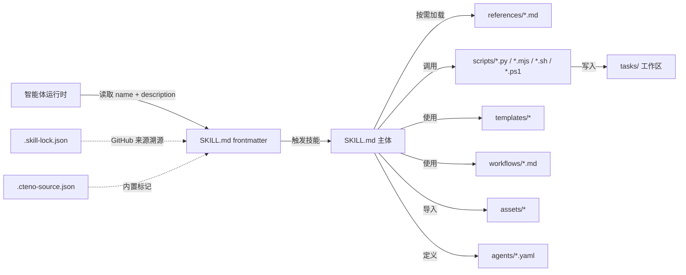

# AGENTS.md

> **此文是给编程 Agent 的项目上下文与全局规则**：放的是**编码任务必读**的契约与红线。

## 仓库协作指南

本仓库是一个经过精心整理的**用户级**[agent 技能](https://agentskills.io)集合——每个技能都是一个自包含的能力包（`prompt + scripts + references + assets`），下游智能体通过 `name` 发现它们，并渐进式加载。本仓库**与框架无关**：任何能从 YAML frontmatter 读取 `name` + `description`、在技能触发时加载 `SKILL.md` 主体、并按需拉取 `references/` / `scripts/` / `templates/` / `assets/` 的运行时都能消费这些技能。少量技能是平台专属的（如面向 OpenCowork 的 `create-extension`、面向 GSD 的 `create-gsd-extension`、面向 Super Agent Party 的 `sap-extension-creator`、`nuxt-ui`、`playwright-dev`）——它们会在各自的 `SKILL.md` 中明确标注。

- **远程仓库**：`git@github.com:pelioo/.agents.git`（默认分支 `main`）
- **权威编写指南**：`skills/skill-creator/SKILL.md` —— 新增技能前请通读全文。
- **Schema 校验器（具体实现）**：`skills/skill-creator/scripts/quick_validate.py` 强制执行本仓库的**本地创作约定**（5 个 frontmatter 键）。`npx -y skills-ref validate` 强制执行**上游参考规范**（6 个键 —— 它额外接受 `compatibility`）。这是两套 schema，不是一套 —— 详见下文「SKILL.md frontmatter」。

## Git 规范

- **提交信息**：`<类型>(<范围>): <简短描述>`，类型 `feat`/`fix`/`docs`/`style`/`refactor`/
  `perf`/`test`/`chore`。**署名**：正文末尾最后一行 `Provenance: agent(<名字> @<端口>)`
  （多实例必须带端口，以区分是谁写的）。
- 本仓**无 CI**（连 `.github/` 都没有）—— 门禁就是「验证过的命令」那节。提交前自查：
  逻辑正确性 / 是否破坏现有测试 / 文档是否同步 / 是否引入不安全模式（`panic`、密钥泄漏）。

## 项目概览

- **用途**：分发、版本化并校验下游智能体通过 `name` 调用的 agent 技能。
- **规模**：`skills/` 下共 87 个技能（持续增长；见 `ls -d skills/*/`）。
- **来源构成**：本地自研 + 从上游拉取（`tavily-ai/skills`、`vercel-labs/skills`、`jimliu/baoyu-skills`、`vikiboss/60s-skills`）。来源溯源记录在 `.skill-lock.json` 与每个技能的 `.cteno-source.json` 中。
- **领域**：用户级技能库。`.skill-lock.json` 的 `lastSelectedAgents` 字段列出了已实测从本仓库安装过技能的运行时（`amp`、`cline`、`codex`、`cursor`、`gemini-cli`、`github-copilot`、`kimi-cli`、`opencode`）—— 仅作参考，不构成领域限制。

---

## 架构与数据流



**三级渐进式披露**（依据 `skills/skill-creator/SKILL.md:114-124`）：

1. **元数据层** —— `name` + `description` 始终在上下文中（约 100 词）。
2. **主体层** —— `SKILL.md` 的 Markdown 主体，在技能被触发时加载（预算 < 5k 词 / **< 500 行**）。
3. **捆绑资源层** —— `references/`、`scripts/`、`templates/`、`workflows/`、`assets/`、`agents/`，按需加载。脚本可以不进入上下文直接执行。

**两层技能注册表**：

| 注册表 | 适用范围 | Schema |
|---|---|---|
| `.skill-lock.json`（根目录，v3） | 来自 GitHub 的安装项（如 `search`、`find-skills`、`weather-query`、`baoyu-translate`） | `{version, skills{source, sourceType, sourceUrl, skillPath, skillFolderHash, installedAt, updatedAt}, dismissed{}, lastSelectedAgents[]}` |
| `skills/<name>/.cteno-source.json`（每个技能一份） | 内置 / 插件来源的技能（`a2ui`、`pptx`、`xlsx`、`browser-automation`） | `{installedAt, sourceKey, sourceType: "builtin"}` |

两者均由工具维护；切勿手工编辑。

---

## 关键目录

| 路径 | 用途 |
|---|---|
| `skills/<name>/SKILL.md` | **必需入口**。YAML frontmatter + Markdown 主体，是运行时最先读取的文件。 |
| `skills/<name>/references/` | 按需加载的长文文档。保持在 `SKILL.md` 下一层。 |
| `skills/<name>/scripts/` | 可执行辅助脚本 —— 以 Python 为主，也有 Node（`.mjs`/`.js`）、Shell（`.sh`/`.ps1`/`.bat`），少量 TypeScript。 |
| `skills/<name>/templates/` | 由智能体填充的输出脚手架（YAML 工作流定义、Markdown 路由表、JSON 声明式 UI）。 |
| `skills/<name>/workflows/` | 指导智能体完成复杂任务的多步骤流程文档（Markdown）。 |
| `skills/<name>/assets/` | 随输出分发的文件（样板项目、图标、字体）。**不会**加载进上下文。 |
| `skills/<name>/agents/` | 罕见。子智能体定义（`product-design`、`project-analysis`）。 |
| `skills/<name>/tests/` | 罕见。每个技能基于标准库 `unittest` 的单元测试（见 `a2ui/tests/`、`weather-query/tests/`）。 |
| `.skill-lock.json` | 工具管理的注册表。GitHub 来源技能 + `lastSelectedAgents`。 |
| `skills/*/.cteno-source.json` | 工具管理的逐技能标记，记录内置安装来源。 |
| `tasks/` | 智能体运行时的临时工作区。内容已被 gitignore；**切勿**在此提交生成物。 |
| `.bitfun/` | IDE 缓存（如 flashgrep 索引）。已 gitignore。 |

**本地覆盖规则** —— `skills/product-design/templates/prototype/AGENTS.md` 规定：原型工作必须自行服务 dev server（自行启动、在 OpenCowork 浏览器中打开），而不是指示用户去做。请把它当作生效规则，而不是提示 —— 其效力与 `AGENTS.md` 中的任何条款相同。

**当前子目录使用情况**（共 87 个技能；数字会漂移 —— 用 `for d in references scripts templates workflows assets agents tests; do printf "%-12s %d\n" "$d" "$(ls -d skills/*/$d 2>/dev/null | wc -l)"; done` 重新生成）：

| 子目录 | 技能数 | 示例 |
|---|---|---|
| `references/` | 22 | `a2ui`、`create-gsd-extension`、`create-mcp-server`、`create-workflow`、`weather-query` |
| `scripts/` | 28 | `skill-creator`、`create-extension`、`product-design`、`pdf`、`a2ui` |
| `templates/` | 6 | `a2ui`、`create-workflow`、`create-skill`、`planning-with-files`、`create-plan`、`docx` |
| `workflows/` | 3 | `create-skill`（9 个工作流）、`create-gsd-extension`（3 个）、`create-workflow`（1 个） |
| `assets/` | 3 | `sap-extension-creator`、`model-thinking`、`article-to-blog` |
| `agents/` | 2 | `product-design`、`project-analysis` |
| `tests/` | 2 | `a2ui`、`weather-query` |

---

## 开发命令

规范的校验 / 分发入口（仓库没有统一的 build / test 运行器）：

```bash
# 在线 schema 校验（通过 npx 拉取 skills-ref）
npx -y skills-ref validate <path>      # 单个技能目录，例如 skills/foo
npx -y skills-ref validate skills      # 整棵树
npx -y skills-ref build <path>         # 打包为 <name>.skill zip
npx -y skills-ref list                 # 清单 + lock 状态
```

离线 Python 校验（无需联网）：

```bash
python3 skills/skill-creator/scripts/quick_validate.py <skill-dir>     # 仅校验 frontmatter schema
python3 skills/skill-creator/scripts/package_skill.py <skill-dir> [out-dir]   # 校验 + 打包
python3 skills/skill-creator/scripts/init_skill.py <name> --path <out-dir>   # 生成骨架
```

值得知道的逐技能内置脚本：

```bash
# 创建 OpenCowork V1 扩展（minimal / http / ui 模板）
python3 skills/create-extension/scripts/create_extension.py <id> --path <dir> --template {minimal|http|ui} [--validate-only]

# 引导 product-design 的 Vite + React 19 原型
node skills/product-design/scripts/bootstrap-prototype.mjs --dest <abs-path>

# 逐技能单元测试（存在时）
python -m unittest skills/a2ui/tests/test_render.py
python -m unittest discover -s skills/weather-query/tests
```

冒烟测试模式（来自 `skills/create-skill/workflows/verify-skill.md:81`）：

```bash
{tool-name} --help | grep "{documented-flag}"
```

---

## 代码约定与常见模式

### SKILL.md frontmatter —— 权威 schema

本仓库通过 `skills/skill-creator/scripts/quick_validate.py:42` 强制执行一份**本地创作白名单**：

```yaml
---
name: my-skill              # 必填。^[a-z0-9-]+$，≤64 字符，不能有开头 / 结尾 / 连续连字符
description: Does X. Use when user asks for Y or mentions Z.   # 必填。≤1024 字符，不能含 < 或 >
license: MIT                # 可选
allowed-tools: Bash(...)    # 可选。逗号分隔的工具作用域
metadata: {}                # 可选。自由格式对象
---
```

> **同时存在两套 frontmatter schema —— 它们并不相同，也没有哪一套是"唯一真理"。**
>
> | Schema | 校验器 | 允许的键 |
> |---|---|---|
> | **本地创作约定** | `skills/skill-creator/scripts/quick_validate.py:42` | `name`、`description`、`license`、`allowed-tools`、`metadata` |
> | **上游参考规范** | `npx -y skills-ref validate` | `name`、`description`、`license`、`allowed-tools`、`metadata`、**`compatibility`** |
>
> `skills/skill-creator/SKILL.md:314` 明确写道 *"Do not include any other fields in YAML frontmatter"*（不要在 YAML frontmatter 中加入其他字段）—— 这是**本地约定**，也是两者中更严格的一套。上游规范**确实**接受 `compatibility`；`skills-ref` 报告的允许键集合为 `allowed-tools, compatibility, description, license, metadata, name`。`skills-ref` 直接拒绝的键：`version`、`slug`、`homepage`、`changelog`、`authors`、`credentials`、`tags`。
>
> **优先取 5 个键的交集**，这样两个校验器都能通过。`compatibility` 在上游是合法键，只有更严格的本地校验器会报错 —— 需要时就用，并在 PR 中说明。上表中其余的键则是真正的违规。
>
> 仓库中现有的部分技能带有非规范键（`version`、`author`、`tags`、`homepage`、`changelog`、`user-invocable`、`risk`、`source`、`date_added`、`official`、`authors`），因为 `package_skill.py` 不会为多余字段重跑 `quick_validate`，而 `skills-ref` 也从未在它们身上跑过。这些是**待修复的违规项，不是可效仿的范例**。开 PR 之前：运行 `python3 skills/skill-creator/scripts/quick_validate.py skills/<name>` **并且** `npx -y skills-ref validate skills/<name>`，并删除两个校验器都拒绝的键。

**description 规则**（完整规则集由 `quick_validate.py:42-90` 强制执行）：
- 单句，同时说明技能*做什么*与*何时触发*（运行时据此决定是否触发）。
- 第三人称。不含 `<` 或 `>` 字符。长度上限由校验器强制。

**实际使用的 allowed-tools 写法**：
- `Bash(npx agent-browser:*), Bash(agent-browser:*)` —— 限定作用域的 bash（skills/agent-browser）
- YAML 列表：`- Read` / `- Write` / `- Edit`（skills/planning-with-files）

### SKILL.md 主体结构

- `# Skill Name` 标题。
- 顶部要有 `## When to use this skill` 或 `## Workflow` 章节。
- 祈使语气；说明能力 / 流程。
- 主体 **< 500 行**（`skills/skill-creator/SKILL.md:124`）。细节移入 `references/`。
- **允许额外的项目文件。** 每个技能都是独立、自包含的项目：`README.md`、`CHANGELOG.md`、`LICENSE`、`CONTRIBUTING.md`、`INSTALLATION.md` 等都可以放在技能顶层。工具链没有任何东西禁止它们 —— `quick_validate.py` 只检查 frontmatter，`package_skill.py` 原样打包整个目录，`skills-ref validate` 对包含这些文件的技能同样返回 `Valid skill`。`SKILL.md` 始终是面向 agent 的入口；面向 agent 的长篇内容应放进 `references/`。
- 用相对路径引用 `SKILL.md` 同级的其他文件，例如 `references/extension-v1.md`。
- 工具调用模式：使用 `{skill_root}` 占位符，例如 `python3 {skill_root}/scripts/foo.py`。

**现存的主体风格**（可作参考）：
- 紧凑触发式 —— `skills/weather-query/SKILL.md`（4 行 frontmatter，4 个主体章节）。
- 标准散文式 —— `skills/find-skills/SKILL.md`（中等篇幅，无 license/metadata）。
- 流程重型、带 XML 标签章节 —— `skills/tdd/SKILL.md`（`<objective>`、`<context>`、`<core_principle>`、`<process>`、`<anti_patterns>`、`<success_criteria>`）。
- 完整散文式 —— `skills/userinterface-wiki/SKILL.md`（约 253 行，规则分类 + 优先级表格）。
- 路由表式（委托给 `references/*.md`）—— `skills/a2ui/SKILL.md` 引用 8 份子文档。

### 命名与格式

- **技能名**：小写连字符分隔（`csv-pipeline`、`find-skills`）。避免版本后缀 —— 少数遗留目录内嵌了版本号（`elite-tools-0.0.1`、`self-improving-1.2.10`、`summarize-1.0.0`）；不要沿用这种模式。
- **脚本入口**：`scripts/<verb>_<noun>.py`（如 `init_skill.py`、`create_extension.py`、`fill_fillable_fields.py`）。
- **参考文件**：与主题对应的 snake / kebab-case 命名（`extension-v1.md`、`audit.md`、`get-context.md`）。
- **缩进**：Markdown 2 空格。**Python** 4 空格（PEP 8）。**JSON / YAML** 2 空格。
- **脚本注释**：只为非显而易见的意图、不变式或边界情况加注释。

### 脚本 —— 常见模式

- **仓库根没有包清单**。没有 `pyproject.toml` / `requirements.txt` / `setup.py` / `Pipfile` / `package.json`。脚本直接通过 `python3` 或 `node` 在全局环境中运行。
- **Python**：标准库 + 按需导入。许多脚本自带辅助函数（如 `pdf/scripts/fill_fillable_fields.py`）。
- **Node**：ESM（`.mjs`），直接通过 `node <script>.mjs` 使用。
- **跨平台配对规则**：同一文件名主干同时提供 **`.sh`（Unix bash）** 与 **`.ps1`（PowerShell）**，以保持操作系统一致。
  - 2 份：`local-tools:calendar.{sh,ps1}`、`planning-with-files:{check-complete,init-session}.{sh,ps1}`
  - 3 份（外加 `.bat` 兼容旧版 CMD）：`weather-query:q.{sh,ps1,bat}`
  - 4 份（外加 `.py` / `.js` 以跨运行时）：`anysearch-skill:anysearch_cli.{sh,ps1,py,js}`
- **内置 CLI 的常用参数**：`--path`、`--template`、`--validate-only`、`--force`、`--dest`、`--help`。用 `--validate-only` 作为冒烟测试入口。
- **没有共享内部库**：每个技能独立自足。不做跨技能的 Python 包导入。

### 工作流 YAML schema V1

`skills/create-workflow/templates/workflow-definition.yaml` —— 权威 schema，版本 1。

**顶层**：`version: 1`（必须是数字）、`name`（非空）、`description`、`params`（字符串→字符串映射；prompt 中做 `{{key}}` 替换）、`steps[]`（非空）。

**步骤字段**：`id`、`name`、`prompt`、`requires[]`（别名 `depends_on`）、`produces[]`、`context_from[]`、`verify`、`iterate`。

**`verify`** 策略（依据 `skills/create-workflow/references/verification-policies.md`，四选一）：
- `content-heuristic` —— 字段：`minSize`、`pattern`
- `shell-command` —— 字段：`command`
- `prompt-verify` —— 字段：`prompt`
- `human-review` —— 无额外字段

**`iterate`** —— 对文件列表做扇出：`{source, pattern}`。`pattern` 必须包含真实的捕获组。

**路径穿越防护**：`produces`、`iterate.source` 与参数值都拒绝 `..`（见 `skills/create-workflow/SKILL.md:39-60`）。

**执行模式**（`skills/create-workflow/SKILL.md:58-72`）：`oneshot`、`yaml-step`、`markdown-phase`、`auto-milestone`。

### 模板与工作流

- `templates/` —— 由智能体填充的输出脚手架（YAML 工作流定义、Markdown 路由表、供 `a2ui` 使用的 JSON 声明式 UI）。
- `workflows/` —— 以 Markdown 形式给出的分步流程文档，指导智能体走完复杂的多步骤任务（9 个示例见 `skills/create-skill/workflows/`）。

---

## 重要文件

| 路径 | 为什么重要 |
|---|---|
| `AGENTS.md` | 本文件，请先读。 |
| `README.md` | 面向用户的中文说明文档，与本文件同源：命令面板与不变式清单保持一致。 |
| `.skill-lock.json` | GitHub 来源技能的溯源信息 + `lastSelectedAgents`。由工具自动维护。 |
| `.gitignore` | Python 字节码、`.bitfun/` 缓存、`/tasks/*`（保留目录）。 |
| `skills/skill-creator/SKILL.md` | **权威**技能编写指南。Schema、结构解剖、渐进式披露、6 步创建流程。新增技能前先读。 |
| `skills/skill-creator/scripts/quick_validate.py` | **本地** 5 键创作约定的 frontmatter 具体校验。上游 6 键规范由 `npx -y skills-ref validate` 强制执行。 |
| `skills/skill-creator/scripts/package_skill.py` | 校验后打包为可分发的 `.skill`。 |
| `skills/skill-creator/scripts/init_skill.py` | 骨架生成器。 |
| `skills/create-workflow/templates/workflow-definition.yaml` | 工作流 V1 YAML 的标准脚手架。编写工作流前先读。 |
| `skills/create-workflow/references/yaml-schema-v1.md` | 完整的 V1 字段参考 + 10 条校验规则。 |
| `skills/create-extension/references/extension-v1.md` | OpenCowork V1 扩展清单规范。修改 `create-extension` 前先读。 |
| `skills/create-skill/workflows/verify-skill.md` | 逐技能内容验证的标准流程。 |
| `skills/product-design/templates/prototype/AGENTS.md` | 本地覆盖规则：原型工作自行服务 dev server（不要指示用户去做）。 |
| `skills/*/SKILL.md` | 每个技能一份。agent 默认只读这一份。 |

---

## 运行时与工具偏好

- **多数内置脚本用 Python**。用 `python3 <script>.py` 运行。仓库层面不需要 virtualenv 或 lockfile。除非脚本自己写明安装方式，否则只用标准库。
- **Node（ESM）** 用于原型脚手架（`bootstrap-prototype.mjs`）以及少数其他辅助脚本。用 `node <script>.mjs` 运行。
- **Shell 包装器**成对提供 `.sh` + `.ps1`（Windows PowerShell）；偶尔为兼容旧版 CMD 提供 `.bat`（见上文跨平台配对）。
- **包管理器**：`npm`（通过 `npx`）用于 `skills-ref` CLI。**仓库层面没有 `package.json`**。
- **没有构建步骤**：技能在运行时按原样消费。只有类 CI 检查会运行 `skills-ref validate`。
- **仓库层面没有测试框架**：逐技能测试使用**标准库 `unittest`**（`python -m unittest <test-file>` 或 `python -m unittest discover -s tests`）。不用 pytest，没有 pytest 配置，也没有 pytest 缓存（尽管 `project-analysis/.gitignore:19` 出于防御性地列了 `.pytest_cache/`）。
- **仓库层面没有 linter / formatter 配置**。逐技能脚本可以有自己的风格，但 schema 只约束 `SKILL.md`。
- **没有 CI 运行器**：没有 `.github/workflows/`、没有 Makefile、没有 `.pre-commit-config.yaml`。校验靠人工或仓库内脚本完成。

---

## 测试与质量保障

本仓库**不**随附自动化测试套件。质量通过以下方式保障：

**1. Schema 校验**（三层）：
```bash
npx -y skills-ref validate skills/<name>              # 完整的在线 schema
npx -y skills-ref validate skills                     # 整棵树
python3 skills/skill-creator/scripts/quick_validate.py skills/<name>   # 仅离线 frontmatter
```

**2. 逐技能单元测试**（目前只有 `a2ui` 与 `weather-query` 提供；按需启用）：
```bash
python -m unittest skills/a2ui/tests/test_render.py
python -m unittest discover -s skills/weather-query/tests
# 模板：skills/a2ui/references/scripts.md:136
```

**3. 逐技能冒烟测试** —— 每个打包了 CLI 辅助脚本的技能都在其 `SKILL.md` 中写明一行验证命令：
```bash
python3 scripts/<script>.py --help                # 模式 A —— 检查 CLI 帮助
python3 scripts/<script>.py --validate-only       # 模式 B —— 无副作用校验
python -m unittest tests/test_<name>.py           # 模式 C —— 标准库 unittest
{tool} --help | grep "{documented-flag}"          # 模式 D —— create-skill 验证流程
```

**4. 人工验证**：由智能体实际调用该技能，确认输出符合预期。当存在大量同类脚本时，取一个代表性样本即可（`skills/skill-creator/SKILL.md:296`）。

**5. 合并前的跨技能不变式**（开 PR 前逐条执行）：
- [ ] 技能目录名与 `name` frontmatter 字段一致。
- [ ] `description` 是说明*做什么* + *何时使用*的单句（≤1024 字符，不含 `<`/`>`）。
- [ ] `SKILL.md` 主体**少于 500 行**；长内容放进 `references/`。
- [ ] `SKILL.md` 是面向 agent 的入口（面向 agent 的细节放进 `references/`）；`README.md` / `CHANGELOG.md` / `LICENSE` / `CONTRIBUTING.md` 是可选的面向人的项目文件，始终允许存在。
- [ ] Frontmatter 通过 `quick_validate.py` 校验（或在 PR 描述中说明非规范键）。
- [ ] Frontmatter 通过 `npx -y skills-ref validate skills/<name>`（或在 PR 描述中说明上游拒绝的键）。
- [ ] 本地跑过 `npx -y skills-ref validate skills/<name>`；把输出粘贴到 PR。
- [ ] `tasks/` 中没有被纳入版本控制的生成物。

---

## Pull Request 规范

- **一个技能一个 PR**，除非改动紧密耦合。
- **提交信息**：祈使语气主题，≤72 字符。按技能标注 scope：`skills/csv-pipeline: add JSON output mode`。
- **PR 描述**：列出受影响的技能、用户可感知的变化、跑过的校验命令。为每个受影响路径粘贴 `skills-ref validate` 输出。
- **切勿提交** `tasks/` 下的生成物或本地编辑历史。工具产生的 `.skill-lock.json` 更新可以提交。
- **对技能设计有疑问时**：先通读 `skills/skill-creator/SKILL.md`。
