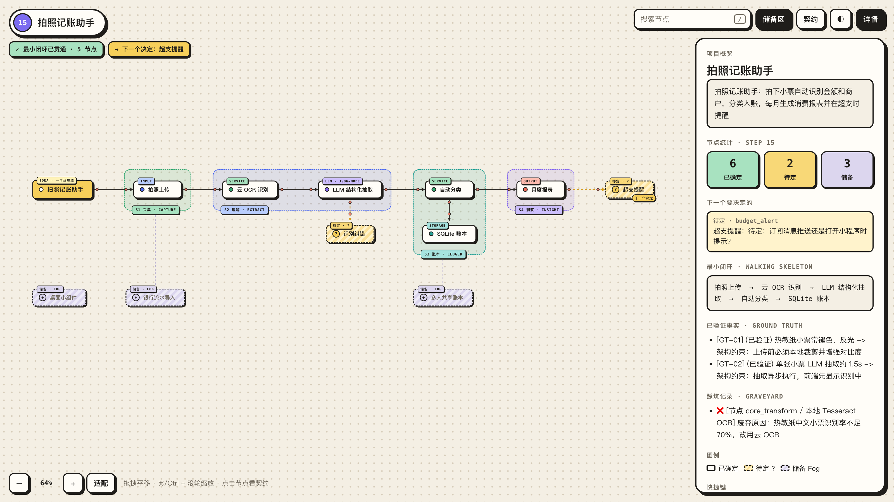
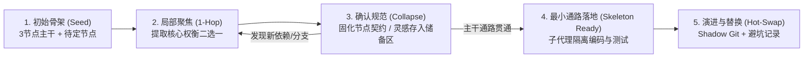

# 🌱 Arch-Grower

> **渐进式架构推演引擎 (Autoregressive Architecture Engine)**  
> 告别事无巨细的重型设计，也拒绝越聊越乱的对话盲写。通过多轮轻量二选一，让软件架构像大模型生成 token 一样，步步为营、自然长成。

[](https://www.python.org/)
[](LICENSE)
[](#)
[](https://modelcontextprotocol.io/)
[](#)

<picture>
  <source media="(prefers-color-scheme: dark)" srcset="docs/images/dashboard-dark.png">
  
</picture>

<sub>↑ 一句话想法“拍照记账助手”经过 15 步推演后，<code>arch export-ui</code> 导出的架构看板（<a href="#dashboard-example">示例详解</a>）。</sub>

---

## 💡 为什么需要 Arch-Grower？

在人与 AI 协作编程中，往往容易走向两个极端：

| 维度 | 传统工程方法 (重型 PRD / 提前全量设计) | 纯对话编程 (Vibe Coding / 聊天式写代码) | **Arch-Grower (渐进式架构演进)** |
| :--- | :--- | :--- | :--- |
| **启动门槛** | **极高**：要求动工前想清全部细节与接口 | **极低**：随便聊几句就开工 | **极低**：一句模糊的想法即可启动最小骨架 |
| **演进方式** | 瀑布式 / 静态死板，后期调整成本高 | 随意漂移，缺乏系统边界约束 | **拓扑增量推演**，逐步消除未决环节 |
| **上下文管理** | 人类维护成本高昂 | **上下文迅速膨胀**：AI 遗忘、胡乱假设、改 A 坏 B | **局部切片聚焦**，主对话专注决策，无业务代码噪音 |
| **发散需求处理** | 容易打乱排期与架构结构 | 随口一聊就把当前开发主线带偏 | **暂缓储备区 (Fog)**：妥善留存灵感，不影响主线 |
| **交付节奏** | 容易纸上谈兵，设计与代码脱节 | 碎片代码堆叠，缺乏系统全局认知 | **最小端到端闭环（Walking Skeleton）优先**，局部通畅即写代码 |

### 破局思路
在**人的直觉意图**与**AI 的代码执行**之间，引入一层**轻量级的图状态机（Graph IR）**。  
用户无需手写长篇 PRD，AI 也无需在主对话里堆砌业务代码；只需针对**关键架构权衡（Trade-off）**做二选一确认（当然也可以向Agent提出你自己的想法），系统就会自顶向下、逐步把初始想法推演为可执行的工程架构。

---

## 🌟 核心设计原则 (Core Principles)

### 1. 允许局部设计留白（Typed Holes 与需求储备）
架构设计无需一次到位。尚未想清的环节在图中标记为待定节点（`🟡 ?`）；暂时不做的发散需求直接放入暂缓储备区（`⚪ fog`）。任何时刻都只聚焦当前关心的 1~2 个节点，降低认知负荷。

### 2. 聚焦核心架构权衡（Trade-off Decisions）
**人定策略方向，机定工程细节**。每一轮演进，引导员只提取当前待定节点背后的**核心技术权衡**（例如：`低延迟允许丢帧` vs `高可靠背压重试`），提供清晰的 A / B 选项；不影响业务体验的底层库选型与参数默认采用业界最佳实践，不拿琐碎细节干扰用户。

### 3. 最小闭环优先（Walking Skeleton）
不等待全景设计完毕才动工。只要端到端连通了一条没有待定节点的通路，立即冻结该主线并生成基础代码（Walking Skeleton），用实际运行反馈驱动后续设计。

### 4. 主从职责解耦（Context Isolation）
**主对话专心负责架构推演与决策，不直接读业务源码、不写具体实现、不粘贴长报错日志**。所有编码与测试均导出为局部任务，委派给**独立的临时子代理（Ephemeral Worker）**在沙箱中完成，保证主对话上下文轻盈、无噪音。

### 5. 意图与实现分离，支持局部调整（Ports & Adapters）
架构主干定义业务意图（Port），具体落地挂载实现适配器（Adapter）。现实运行踩坑时主干拓扑保持稳定，仅重置报错节点重新选择适配器，并将失败教训记录进踩坑备忘（`graveyard.md`），避免大模型重复踩坑。

### 6. 阶段泳道模型（Stage Swimlane）
横向按生命周期划分阶段（Stage 1 ➔ Stage 2 ➔ Stage 3），纵向容纳阶段内的并发分支与特性储备。随时可一键导出交互式 HTML 看板。

---

## 🔄 5 步通用演进流程



---

<a id="dashboard-example"></a>

## 🖼️ 看板示例：从一句话到一张架构图

以一个典型的 vibe coding 需求为例：

> “我想做个**拍照记账助手**：拍下小票自动识别金额和商户，分类入账，每月生成消费报表，超支了提醒我。”

纯聊天写代码时，这类需求很容易一口气堆成一团：OCR、LLM、数据库、推送、多人账本混在同一轮对话里。用 arch-grower 推演 15 步后，执行 `arch export-ui` 得到的就是页首那张图（另有[亮色](docs/images/dashboard-light.png) / [暗色](docs/images/dashboard-dark.png)原图，以及可交互的[示例 HTML](docs/examples/expense-tracker-dashboard.html)：下载后用浏览器打开，离线可用）。

**怎么读这张图**

| 图上元素 | 含义 | 本例中的内容 |
| :--- | :--- | :--- |
| 黄色 `IDEA` 卡片 | `SEED.md` 中的一句话初始意图 | 拍照记账助手 |
| 白色实线卡片 | 已确定节点（`solid`），左上角标签是节点类型 | 拍照上传 → 云 OCR 识别 → LLM 结构化抽取 → 自动分类 → 月度报表 |
| 虚线彩色框 + 底部标签 | 同一 `--stage` 的节点归为一组 | S1 采集 / S2 理解 / S3 账本 / S4 洞察 |
| 黄色斜纹 `?` 卡片 | 待定节点（`hole`），等待下一轮二选一 | 超支提醒（订阅推送还是打开时提示？）、识别纠错（低置信度是否强制人工确认？） |
| 紫色斜纹 `+` 卡片 | 储备需求（`fog`），虚线挂在所属阶段下 | 银行流水导入、多人共享账本、桌面小组件 |
| 分支与下挂节点 | 主干之外的分支，叶子节点挂在上游正下方 | SQLite 账本挂在自动分类下 |
| 左上角绿色徽章 | 引擎找到的最小闭环（Walking Skeleton） | 拍照上传 → 云 OCR 识别 → LLM 结构化抽取 → 自动分类 → SQLite 账本，5 节点已贯通，可以交给子代理落地 |
| 黄色“下一个决定”徽章 | 引擎建议下一轮先讨论的待定节点，点击跳转 | 超支提醒 |
| 连线上的契约标签 | 选中节点时显示它上下游连线的契约；工具栏“契约”按钮可显示全部 | 自动分类 → 月度报表：带类别的交易记录 |
| 右侧面板 | 项目概览；点击节点后切换为该节点的规范、输入/输出契约、源码绑定，以及可一键复制的下一步命令 | 2 条已验证事实、1 条踩坑记录（本地 Tesseract 识别率不足，改用云 OCR） |

画布支持拖拽平移、⌘/Ctrl + 滚轮缩放、`F` 适配视图；`/` 搜索节点，`←` `→` 沿连线走到上下游，`↑` `↓` 在同一阶段内切换，`Esc` 取消选择。选中节点后地址栏会带上 `#节点ID`，可以直接分享到某个节点（例如 [`#categorize`](docs/examples/expense-tracker-dashboard.html#categorize)）。工具栏可隐藏储备区、切换亮/暗主题（默认跟随系统）。看板是 `graph.json` 的只读快照，图变更后重新执行 `export-ui` 即可。

<details>
<summary>复现这张图的完整命令（15 步推演）</summary>

```bash
arch init --seed "拍照记账助手：拍下小票自动识别金额和商户，分类入账，每月生成消费报表并在超支时提醒"

# 主干：每个 collapse 对应一轮二选一确认
arch collapse --node entry_input --label "拍照上传" --spec "小程序拍照或相册选图，本地裁剪与对比度增强后上传" \
  --type input --stage "S1 采集 · CAPTURE" --out-contract "JPEG 小票图 ≤ 2MB"
arch collapse --node core_transform --label "本地 Tesseract OCR" --spec "端侧 Tesseract 识别小票文字" \
  --type service --stage "S2 理解 · EXTRACT"
arch reset-node --node core_transform --reason "热敏纸中文小票识别率不足 70%，改用云 OCR"   # 踩坑，写入 graveyard
arch collapse --node core_transform --label "云 OCR 识别" --spec "调用云 OCR 返回文字与版面坐标" \
  --type service --stage "S2 理解 · EXTRACT"
arch add-node --node llm_extract --label "LLM 结构化抽取" --spec "从 OCR 原文抽取金额、商户、日期，JSON 模式输出并做金额校验" \
  --status solid --type "llm · json-mode" --stage "S2 理解 · EXTRACT" \
  --after core_transform --before final_output --contract "OCR 原文 + 版面坐标"
arch add-node --node categorize --label "自动分类" --spec "规则优先、LLM 兜底，把交易归入餐饮/交通/日用等类别" \
  --status solid --type service --stage "S3 账本 · LEDGER" \
  --after llm_extract --before final_output --contract "{amount, merchant, date}"
arch set-edge-contract --from categorize --to final_output --contract "带类别的交易记录"
arch collapse --node final_output --label "月度报表" --spec "按月聚合分类支出，生成图表卡片" \
  --type output --stage "S4 洞察 · INSIGHT"
arch add-node --node ledger_db --label "SQLite 账本" --spec "单机 SQLite 存储交易与类别规则" \
  --status solid --type storage --stage "S3 账本 · LEDGER" --after categorize --contract "交易记录行"

# 还没想清的环节留成待定节点
arch add-node --node budget_alert --label "超支提醒" --spec "待定：订阅消息推送还是打开小程序时提示？" \
  --after final_output --contract "月度分类合计 vs 预算"
arch add-node --node manual_fix --label "识别纠错" --spec "待定：低置信度结果是否强制人工确认" \
  --after llm_extract --contract "置信度 < 0.8 的字段"

# 发散想法放进储备区，不打断主线
arch add-node --node fog_bank --label "银行流水导入" --spec "导入 CSV 账单自动对账" --status fog --stage "S1 采集 · CAPTURE"
arch add-node --node fog_family --label "多人共享账本" --spec "家庭成员共同记账" --status fog --stage "S3 账本 · LEDGER"
arch add-node --node fog_widget --label "桌面小组件" --spec "桌面显示本月剩余预算" --status fog

# 现实约束沉淀为 Ground Truth
arch verify --fact "热敏纸小票常褪色、反光" --constraint "上传前必须本地裁剪并增强对比度"
arch verify --fact "单张小票 LLM 抽取约 1.5s" --constraint "抽取异步执行，前端先显示识别中"

arch export-ui   # → .arch/dashboard.html
```

</details>

---

## 📂 项目结构

本项目保持**零第三方 Python 依赖（Zero External Dependencies）**，使用标准库即开即用：

```text
arch-grower/
├── SKILL.md                 # Agent 核心引导规范与开箱配置
├── MANIFESTO.md             # 架构演进哲学与核心设计原则
├── scripts/
│   ├── arch_cli.py          # 纯标准库状态机、1-Hop 切片器与 Shadow Git 引擎
│   ├── arch_mcp.py          # 标准 Stdio MCP (Model Context Protocol) 服务端
│   └── dashboard_template.html  # export-ui 使用的单文件看板模板（零外部依赖，离线可用）
├── tests/
│   └── test_arch_cli.py     # 标准库 unittest 回归测试：python3 -m unittest discover -s tests
├── docs/
│   ├── images/              # README 中的看板截图（亮色 / 暗色）
│   └── examples/            # 可直接打开的看板示例 HTML
└── references/
    ├── onboarding_tutorial.md   # 5 分钟交互式新手演练剧本
    ├── stage_patterns.md        # 阶段内并发并行与多态设计模式
    ├── execution_and_hotswap.md # 初次交付、已落地节点变更与热替换
    └── grounding_guide.md       # 现实世界黑盒约束与硬件边界确认指南
```

---

## 🚀 快速上手

### 方式一：作为 AI Agent 技能载入 (推荐)

兼容 **Google Antigravity**、**Claude Code**、**Cursor**、**Gemini CLI** 等支持 Skill 规范的 Agent 环境：

```bash
# 克隆仓库到个人技能目录（以 ~/.agents/skills 为例）
git clone https://github.com/Tobi1chi/arch-grower.git ~/.agents/skills/arch-grower

# 若使用 Antigravity，可直接软链接至配置目录：
mkdir -p ~/.gemini/config/skills
ln -s ~/.agents/skills/arch-grower ~/.gemini/config/skills/arch-grower
```

在对话窗口中输入：
> *“@arch-grower 我想做一个根据本地 Markdown 知识库自动生成播客音频的工具”*  
> 即可启动架构推演引导流程。

---

### 方式二：作为原生 MCP (Model Context Protocol) 服务运行

`arch_mcp.py` 实现了无额外依赖的标准 JSON-RPC Stdio MCP 协议，可直接注册到支持 MCP 的宿主工具中。

> **项目目录**：引擎把状态写在工作目录下的 `.arch/` 中。不同宿主启动 MCP 进程时的工作目录不一定是你的项目（Claude Desktop 与全局配置尤其如此），请用环境变量 `ARCH_ROOT` 指定项目根目录。

#### 1. Claude Desktop / Claude Code 配置 (`claude_desktop_config.json`):
```json
{
  "mcpServers": {
    "arch-grower": {
      "command": "python3",
      "args": ["/path/to/arch-grower/scripts/arch_mcp.py"],
      "env": { "ARCH_ROOT": "/path/to/your/project" }
    }
  }
}
```

#### 2. Cursor IDE (`.cursor/mcp.json`):
```json
{
  "mcpServers": {
    "arch-grower": {
      "command": "python3",
      "args": ["/path/to/arch-grower/scripts/arch_mcp.py"],
      "env": { "ARCH_ROOT": "/path/to/your/project" }
    }
  }
}
```

---

### 方式三：作为命令行 CLI 工具单机体验

从目标项目根目录运行以下命令。架构状态保存在该目录的 `.arch/`。将脚本路径替换为实际的技能安装路径。

```bash
ARCH_GROWER_CLI="/实际安装路径/arch-grower/scripts/arch_cli.py"
arch() { uv run --no-project "$ARCH_GROWER_CLI" "$@"; }

# 1. 仅在尚未初始化架构图的项目中执行
arch init --seed "实时多模态翻译耳机，BLE 输入到骨传导输出"

# 2. 查看已有节点的局部切片
arch focus --node entry_input

# 3. 确认初始图中的输入节点
arch collapse \
  --node entry_input \
  --label "BLE 音频接收器" \
  --spec "监听低功耗蓝牙音频流，按 200ms 分片压入内存队列" \
  --stage "S1-Ingestion"

# 4. 把暂缓开发的发散想法放入储备区
arch add-node \
  --node fog_cloud_backup \
  --label "云端录音备份" \
  --spec "异步上传分片至 S3" \
  --status "fog"

# 5. 主干稳定后，把成熟子图折叠为一个超级节点（需要修改时用 unfold 展开）
#    只能折叠已确定的节点：这里假设 core_transform 与 final_output 已经 collapse
arch fold \
  --nodes "core_transform,final_output" \
  --id translate_out \
  --label "翻译与输出模块" \
  --spec "将音频分片翻译后经骨传导播放"

# 6. 导出交互式架构看板 HTML
arch export-ui
# 浏览器打开 .arch/dashboard.html 即可查看全局架构看板（离线可用）：
#   点击节点查看上下游与契约；/ 搜索，← → 沿连线走，↑ ↓ 同阶段切换，Esc 取消
# 看板是 graph.json 的只读快照，图更新后重新执行 export-ui
```

用 `arch <子命令> --help` 查询参数。已落地项目的修改流程见[执行与变更手册](references/execution_and_hotswap.md)。

---

## 🛠️ MCP 工具 / CLI 命令清单

| 原生 MCP 工具名 | CLI 命令 | 作用说明 |
| :--- | :--- | :--- |
| `arch_init` | `init` | 初始化项目状态机，创建带待定节点的初始主干与 Shadow Git 仓库 |
| `arch_focus` | `focus` | 获取当前待定节点的局部上下文、项目目标约束与切片视图 |
| `arch_collapse` | `collapse` | 确定待定节点或更新已确定节点的规范并记录快照 |
| `arch_set_edge_contract` | `set-edge-contract --from <起点> --to <终点> --contract <契约>` | 更新一条已有连线的契约 |
| `arch_add_node` | `add-node` | 在图中增量插入新节点（可指定前驱/后继连线与生命周期 Stage） |
| `arch_add_fog` | `add-node --status fog` | 快捷工具：将发散想法放入迷雾储备区，保持主干清晰聚焦 |
| `arch_deactivate`| `deactivate` | 将活跃节点移入暂缓储备区，自动缝合上下游依赖连线 |
| `arch_activate` | `activate` | 将储备区的节点重新激活为待定节点并接入主线 |
| `arch_verify` | `verify` | 将用户实测确认的现实事实与推导出的硬约束写入 `ground_truth.md` |
| `arch_ground` | `ground` | 挂载外部资料或探针（文档、命令、代码引用）到 `grounding.json` |
| `arch_export_task`| `export-task` | 导出单节点的独立编码任务卡（专供临时子代理在沙箱中执行） |
| `arch_commit_node`| `commit-node --node <节点> --file-path <项目内源码路径>` | 验证后提交快照并绑定实现代码路径 |
| `arch_sync_manual`| `sync-manual` | 感知人类在 IDE 中的手动修改，同步快照以解除防覆盖拦截 |
| `arch_reset_node` | `reset-node` | 将节点重置为待定，保留连线并记录替换原因 |
| `arch_fold` | `fold` | 将已确定、彼此连通的子图折叠为一个超级节点（子节点与内部连线完整保存，对外连线与契约保留），降低认知负荷 |
| `arch_unfold` | `unfold` | 展开超级节点并原样恢复；折叠期间新增的连线自动接到唯一的入口/出口子节点，无法判断时通过 `attach` 指定 |
| `arch_fork` | `fork` | 从历史快照分叉，已绑定节点的代码文件随图一并回滚（保留避坑记录；存在未提交改动时拒绝执行） |
| `arch_export_ui` | `export-ui` | 导出单文件交互式架构看板 HTML（阶段分组、连线与契约、最小闭环、搜索、深链与键盘导航），默认 `.arch/dashboard.html` |

---

## 🛑 设计准则与实践约束

在二次开发或接入本引擎时，建议遵循以下准则：

1. **专注状态流转与切片推演，避免重型可视化**：图形看板只是状态的可视化投影，核心价值在于人机对话驱动的状态流转。
2. **禁止大模型全量覆盖状态文件**：大模型不得直接覆写 `graph.json`，必须通过 CLI / MCP 提供的原子命令进行增量变更，保证图状态的一致性。
3. **主对话与代码实现严格解耦**：主对话专注于架构推演与设计决策；具体业务代码编写与单元测试交由独立子代理完成，避免长对话被实现细节与报错日志污染。
4. **未明确接口定义前不盲目编码**：只有当节点的输入输出契约与依赖明确时，才交由子代理落地代码，拒绝凭空臆造。

---

## 🤝 参与共创

欢迎提交 Issue 与 Pull Request！如果你对以下方向感兴趣，随时加入讨论：
- [ ] 针对更多 Agent 运行环境的原生适配器
- [ ] 更加智能的架构权衡（Trade-off）自动探测算法
- [ ] 更加丰富的阶段泳道交互与依赖拓扑渲染模板

---

## 📄 开源许可证

本项目基于 [MIT License](LICENSE) 开源。
